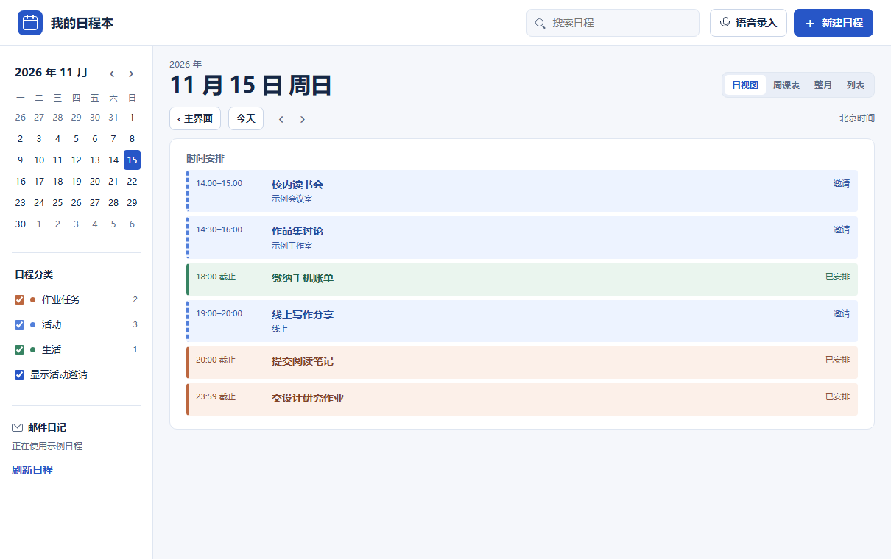

# Codex Calendar Helper

Turn an inbox diary into a calendar you can scan. Codex Calendar Helper reads a local Markdown diary, pulls out dated assignments, activities, and personal reminders, and displays them alongside events you add by typing or speaking Chinese.



## Try it in a minute

Open a terminal in a downloaded or cloned copy of this repository. With Python 3.10 or newer, run:

```sh
python schedule_app.py --demo --open
```

On systems where Python 3 is called `python3`, use that command instead. Demo mode loads synthetic events around today's date and discards changes when the server stops. The app uses Python's standard library and opens at [http://127.0.0.1:8765](http://127.0.0.1:8765). If the default port is in use, add `--port 8766`.

## See what needs your attention

- **Day view** lists the whole day by time and wraps long titles. **Week view** groups overlapping events with expandable lists. The month and agenda views give you a wider look.
- **Assignments, activities, and personal reminders** have their own colors and filters. You can hide invitations until you want to review them.
- **Original email links** appear below imported events when the diary includes an exact Gmail message link. Gmail opens separately so your calendar stays where you left it. The back button returns from a secondary calendar view to the main week.
- **Chinese voice entry** turns a phrase like `明天下午三点在图书馆开组会` into a draft. Review its date, time, and place before saving. You can also type the same phrase or fill in a form.

## Connect your own diary

1. Use the [example diary](examples/diary.example.md) as a template. Copy it to `每日记录.md` next to `schedule_app.py`, then replace the sample date heading with today's date in `YYYY-MM-DD` format. Keep the file in UTF-8.
2. Start the app with `python schedule_app.py --open`. On Windows you can also double-click `start-schedule.cmd` to open the app in an Edge window.
3. Keep writing to the same diary. If you already have a Codex automation with Gmail access, point its output to this file. Ask it to use the category headings in the template, write explicit dates or times, and preserve any original Gmail message links. The calendar reads the Markdown and refreshes while open. Gmail access and the update schedule are configured in that automation.

The current interface and import format are in Simplified Chinese. Calendar and relative-date parsing use Asia/Shanghai (UTC+08:00). Check imported times before relying on them for deadlines. Browser speech recognition needs microphone permission and can depend on the browser's online speech service. Typed entry uses the local parser.

To store your diary and calendar data in a separate folder, run `python schedule_app.py --data-dir PATH --open` and move the diary into that folder.

Manual entries are stored in the local SQLite database under `.dailyhelper/`. The server listens on the loopback address. Keep your actual diary, email links, and database out of public commits and issue reports.

## 中文快速上手

运行 `python schedule_app.py --demo --open` 就能试用示例日程。要导入自己的数据，把 [示例日记](examples/diary.example.md) 复制为项目目录下的 `每日记录.md`，把日期标题改成当天，再运行 `python schedule_app.py --open`。Windows 也可以双击 `start-schedule.cmd`。已有 Codex Gmail 自动化的话，把输出指向同一份 Markdown，日历打开时会读取更新。

## Feedback

Have a diary format that the parser misses? Open an issue with a small, fictional Markdown example, the expected calendar entry, and your platform and browser. If the project is useful, a star helps other people find it.
